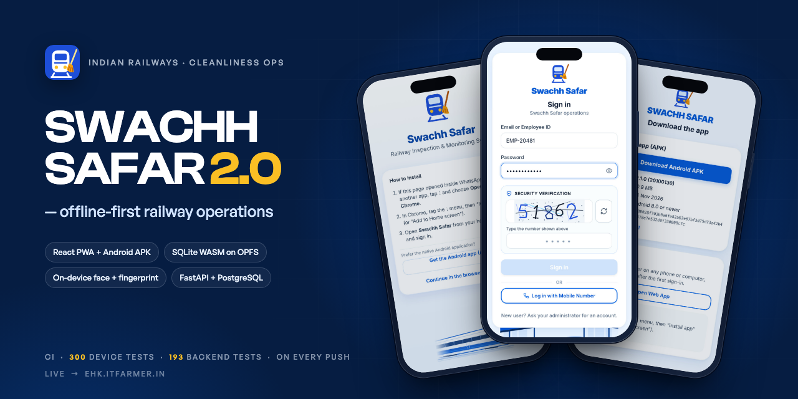

  I build AI products and the dependable software around them: 
  RAG assistants, FastAPI backends, offline-first apps and ERPNext automation. 
  Currently <b>AI Intern @ NivaSync Infotech</b> &nbsp;·&nbsp; B.Tech CS&amp;T, L.J. Institute, class of 2027 &nbsp;·&nbsp; <b>open to internships and full-time roles</b>

  
  
  
  

### `01` &nbsp;Featured: Swachh Safar 2.0

  

An offline-first cleanliness-operations platform for Indian Railways divisions. Staff work inside moving coaches, in tunnels and in yards with no network, so every write is local-first.

- **One React codebase, two targets.** It ships as an installable PWA and a signed Android APK (Capacitor 8). SQLite WASM on OPFS is the source of truth on the phone until the FastAPI + PostgreSQL server acknowledges each record, and fixes reach phones over the air.
- **Attendance on the device.** A live-camera face match and USB-OTG fingerprint capture through a Kotlin Capacitor plugin. It stores templates only, never face or fingerprint images.
- **Tested before it ships.** Every push to main runs 300 device tests on real SQLite and 193 backend tests on a throwaway PostgreSQL in GitHub Actions before a release goes out. 11 offline end-to-end Playwright specs cover the browser flows.

Team project; I am the primary contributor.

**[Live app](https://ehk.itfarmer.in)** &nbsp;·&nbsp; **[Download the APK](https://ehk.itfarmer.in/download)** (Android 8.0+) &nbsp;·&nbsp; **[Repository](https://github.com/Anshum25/swachhsafar)**

### `02` &nbsp;Selected work

<table>
  <tr>
    <td width="50%" valign="top">
      <b><a href="https://github.com/Anshum25/ai_erpnext">ai_erpnext</a></b> 
      An AI assistant inside ERPNext v16 Desk. It looks up records with the user's own permissions and builds Draft documents from a chat or from invoice and order images. It never submits, cancels or pays. 
      Python · Frappe v16 · OpenAI / Gemini / Groq · pypdfium2 · CI
    </td>
    <td width="50%" valign="top">
      <b><a href="https://github.com/Anshum25/ChessMentor">ChessMentor</a></b> 
      A chess coach. Stockfish evaluates every move, an LLM explains it, and a learning engine turns your weaknesses into missions. 
      FastAPI · PostgreSQL · python-chess · LiteLLM · Next.js 15 · TypeScript
    </td>
  </tr>
  <tr>
    <td width="50%" valign="top">
      <b><a href="https://github.com/Anshum25/cbt-system">cbt-system</a></b> 
      Grades handwritten Hindi exam answers. Gemini OCR reads the sheets, an LLM scores them against rubrics on a Celery queue, and teachers review, calibrate and override. 
      FastAPI · Celery · Redis · PostgreSQL · Gemini · React · TypeScript
    </td>
    <td width="50%" valign="top">
      <b><a href="https://github.com/Anshum25/agrismart-ai">agrismart-ai</a></b> &nbsp;<a href="https://agrismart-ai-wheat.vercel.app">live</a> 
      An offline crop doctor, built as a team for Smart India Hackathon 2026. It diagnoses 38 diseases across 14 crops on the phone with ONNX, shows a Grad-CAM heatmap and gives advice in 9 languages. 
      React · PWA · onnxruntime-web · FastAPI · Groq · Leaflet
    </td>
  </tr>
  <tr>
    <td width="50%" valign="top">
      <b><a href="https://github.com/Anshum25/churn-platform">churn-platform</a></b> &nbsp;<a href="https://churn-dashboard-three.vercel.app">live</a> 
      Upload a customer CSV and get churn scores with per-customer SHAP reasons, recommended actions and a Gemini agent that answers questions about at-risk revenue. 
      scikit-learn · XGBoost · SHAP · FastAPI · Gemini · React · Recharts
    </td>
    <td width="50%" valign="top">
      <b><a href="https://github.com/Anshum25/business_health_checkup">business_&#8203;health_&#8203;checkup</a></b> 
      A manufacturing health-check spreadsheet turned into a Frappe app: 150-question assessments over 10 departments, scoring, gap analysis, a 90-day plan and management reports. 
      Python · Frappe v16 · MariaDB · Jinja print formats
    </td>
  </tr>
</table>

### `03` &nbsp;Stack

 
<b>AI &amp; ML</b> &nbsp;·&nbsp; LLMs · RAG · embeddings · semantic search · Qdrant · LangChain · Ollama · XGBoost · SHAP · OCR · Gemini, OpenAI and Groq APIs

 
<b>Backend</b> &nbsp;·&nbsp; REST APIs · JWT / RBAC · SQLAlchemy · Alembic · Celery · ERPNext and Frappe (workflows, reports, server and client scripts)

 
<b>Frontend &amp; mobile</b> &nbsp;·&nbsp; PWA · Capacitor · SQLite WASM on OPFS · Vitest · Playwright

 
<b>Infra</b> &nbsp;·&nbsp; Docker · Linux · nginx · AWS · Vercel · GitHub Actions · Git · Postman

### `04` &nbsp;Activity

<picture>
  <source media="(prefers-color-scheme: dark)" srcset="https://raw.githubusercontent.com/Anshum25/Anshum25/output/github-snake-dark.svg">
  <source media="(prefers-color-scheme: light)" srcset="https://raw.githubusercontent.com/Anshum25/Anshum25/output/github-snake.svg">
  
</picture>

<i>There is so much left to build.</i>

<a href="https://theanshumdev.site">theanshumdev.site</a> &nbsp;·&nbsp; Ahmedabad, India

